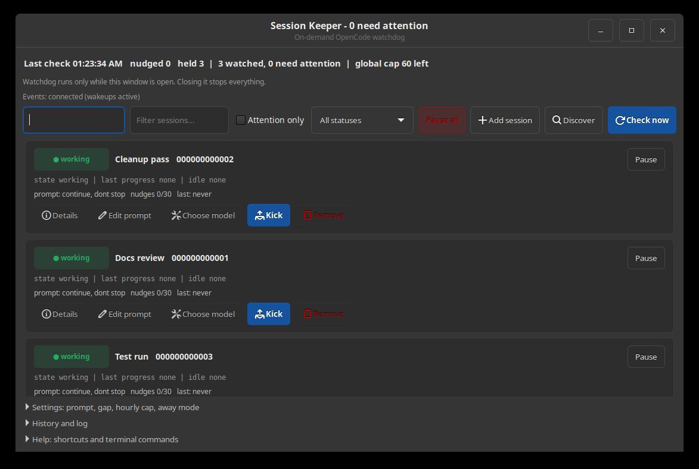

# Session Keeper (Rust)

[](https://github.com/sahilwasgood/session-keeper-rust/actions/workflows/ci.yml)
[](LICENSE)



A small on-demand watchdog for OpenCode sessions. Nothing runs at boot. Open the window when you need it; the watchdog runs only while the window is open, and closing it stops everything. A single-instance lock prevents two watchers from nudging the same sessions.

## What it does

- Reads the OpenCode database read-only and checks watched sessions every tick (default 30s, configurable 5 to 300). Relevant OpenCode SSE events (`session.idle`, `session.status`, `permission.asked`, `form.created`) wake a check immediately; the timer remains as a fallback. The window shows whether the event stream is connected.
- Sends the "continue" nudge to sessions that go idle, with a two-check debounce, unchanged-output loop detection, per-session and global hourly caps, and question/stopped-session guards. Question detection tolerates a trailing newline and the fullwidth `？` mark.
- Alerts you when a session asks a question, stalls after a nudge, disappears from OpenCode, or the nudge cap is reached. Notifications use `notify-send` and have a configurable cooldown; a missing `notify-send` is reported once in the log instead of failing silently.
- Writes a reason-coded decision log, a nudge audit history, and exports settings plus history plus log to `~/session-keeper-audit.txt`.

## GUI

- Session cards with status badge, reason, model, effective prompt, nudge count against the per-session cap, and time-in-state. The status line shows the remaining global cap.
- Per-session buttons: Details, Edit prompt, Model, Kick (with 10s cooldown), Remove, Pause/Resume.
- Filter by id or title, "Attention only" toggle, priority or name sorting.
- One-click **Pause all / Resume all** in the toolbar; it stays in sync with CLI changes to the global switch. A corrupt state file produces a startup warning and keeps a timestamped backup.
- Settings: default prompt, min gap, per-session cap, global cap, away mode, tick interval, alert cooldown, global off switch, dry run, notifications, Pause/Resume all, export/import settings, reload from disk. "Test notification" reports whether a desktop notification was actually sent.
- History and log panel, keyboard shortcuts: F5 check, Ctrl+F filter, Ctrl+E audit export, Ctrl+Q quit.

## CLI (no window needed)

```
session-keeper-rust                       open the GUI
--check-now [--json]                      one watchdog tick, optionally machine-readable
--status [--json]                         session statuses, optionally machine-readable
--doctor                                  check database, credentials, API and notifier
--watch                                   continuous terminal watchdog
--kick <sid>                              nudge one session now
--models [filter]                         list available models
--set-model <sid> <id> <provider>         switch a session's model
--pause <sid> | --resume <sid>            change one session's enabled state
--set-prompt <sid> <text>                 change that session's nudge prompt
--export-state <path> | --import-state <path>   backup / restore state.json
--export-audit                            write history + log to ~/session-keeper-audit.txt
--dry-run                                 preview decisions, send no nudges
--version | --help
```

## Configuration

Defaults follow a standard OpenCode install: database `~/.local/share/opencode/opencode.db`, server `http://127.0.0.1:4096`, credentials `~/.config/opencode/service.json`, and app state under `~/.config/session-keeper/`. No setup is needed if OpenCode is installed in the usual locations.

To override any path or the API address, put `KEY=value` lines in `~/.config/session-keeper/env` (one per line, `#` comments allowed). Real environment variables take precedence. Available keys: `SESSION_KEEPER_DB`, `SESSION_KEEPER_DRIVE`, `SESSION_KEEPER_STATE`, `SESSION_KEEPER_HISTORY`, `SESSION_KEEPER_LOG`, `SESSION_KEEPER_API`, `SESSION_KEEPER_SERVICE_JSON`, `SESSION_KEEPER_LOCK`, `SESSION_KEEPER_AUDIT`, `SESSION_KEEPER_DRY_RUN`, `SESSION_KEEPER_NOTIFY`.

## Files

State and history live in `~/.config/session-keeper/`. Nothing runs at boot and no background daemon is installed. Log and history files rotate automatically. The compiled binary is self-contained; no runtime data files ship with it.

## Build from source

Linux with GTK3 development headers is required:

```
sudo apt-get install libgtk-3-dev libglib2.0-dev pkg-config
cargo test
cargo build --release
install -m 755 target/release/session-keeper-rust ~/.local/bin/session-keeper-rust
```

CI runs the full test suite and a release build on every push and pull request.

## Project notes

The `AUTONOMOUS/` directory holds development-time task boards, research, and handoff notes. It is not required to build or run the application.

## License

MIT. See [LICENSE](LICENSE).
